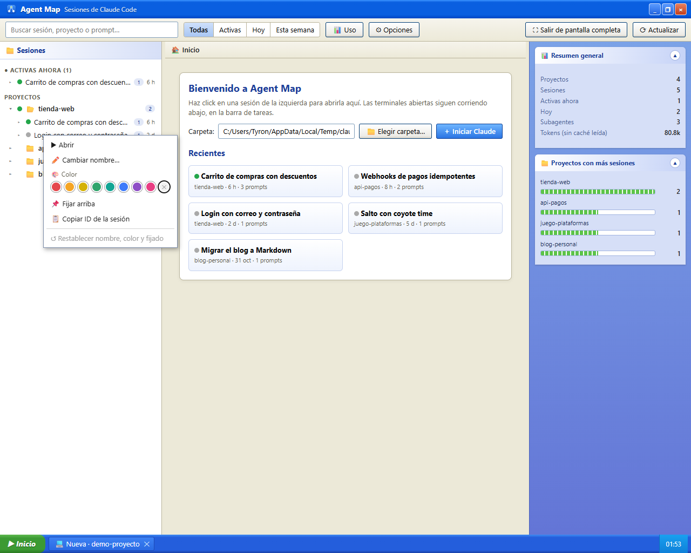
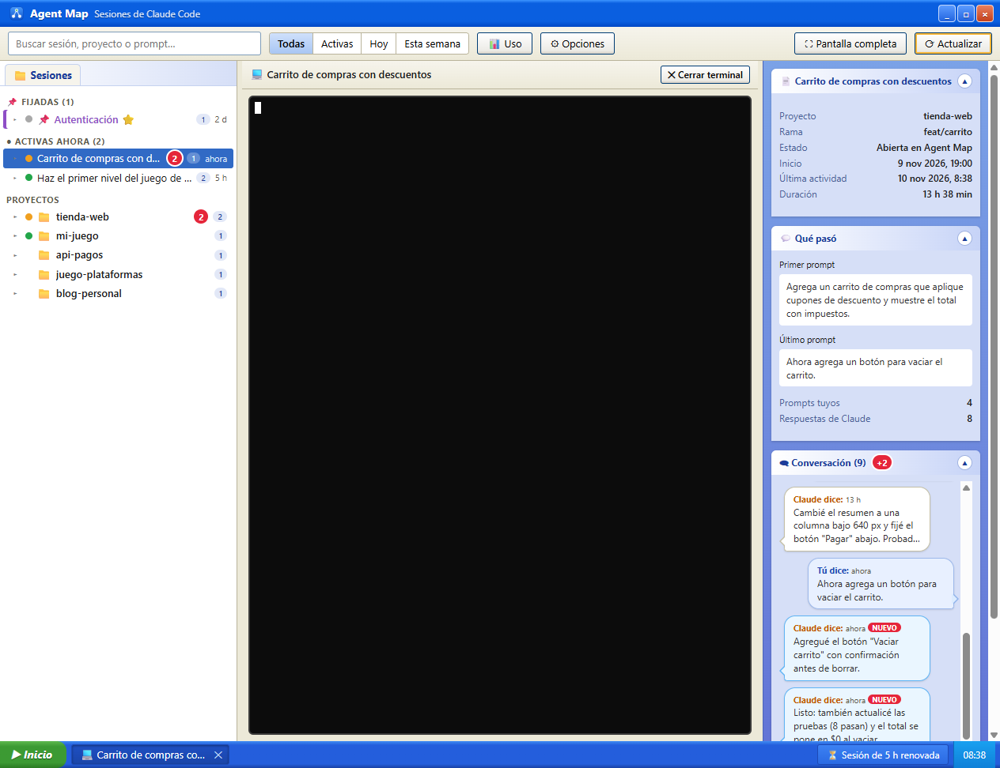
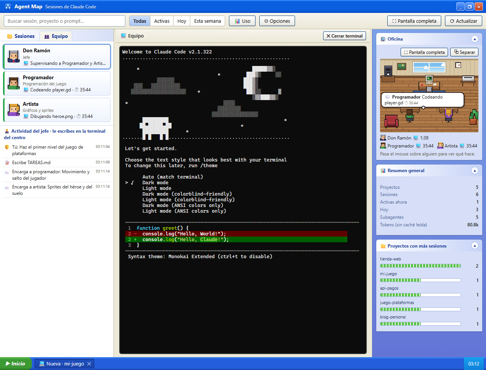
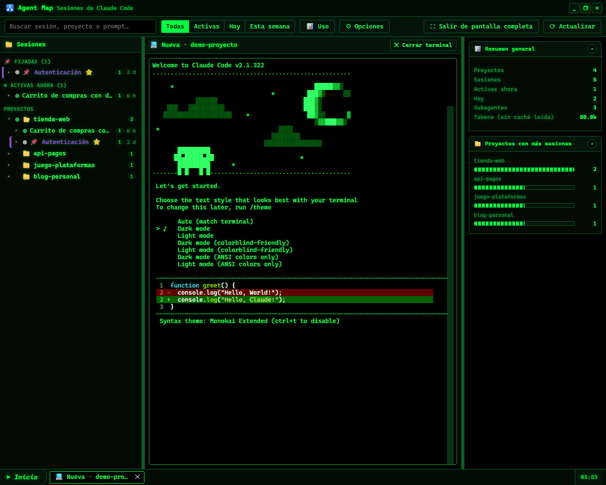

# Agent Map

**Todas tus sesiones de Claude Code en una sola ventana: ordenadas, en vivo y con terminales reales.**

Agent Map es una aplicación de escritorio para Windows que convierte el historial que Claude Code guarda en tu equipo en un panel de control. Ves cada proyecto y cada conversación, sabes al instante qué sesión está trabajando, cuál te espera y cuál terminó, y retomas cualquiera con un click en una terminal real dentro de la misma ventana. Todo es local: no hay cuentas, servidores externos ni telemetría.


**[⬇ Instalador para Windows (última versión publicada)](https://github.com/TyronQuezada/agent-map/releases/latest)** · [Manual completo](MANUAL.md) · [Cambios](CHANGELOG.md)

> Las mejoras de la etapa 2.0 descritas abajo están en la rama `main`. La última versión publicada con instalador es la 0.8.0; las novedades llegarán en el próximo instalador.

---

## ¿Qué problema resuelve?

Claude Code vive en la terminal. Cuando trabajas en varios proyectos, o con varias sesiones a la vez, aparecen las preguntas de siempre: *¿en qué carpeta estaba esa conversación?, ¿cuál era su id para `claude --resume`?, ¿ya terminó la tarea que dejé corriendo?, ¿me está pidiendo permiso en otra ventana?*

Agent Map responde todo eso en una sola pantalla:

| Solo con la terminal | Con Agent Map |
|---|---|
| Buscar a mano el id de una sesión para `claude --resume` | Click en la sesión y se abre en su carpeta |
| Recorrer ventanas para ver si Claude terminó o espera permiso | Punto de estado por sesión y aviso en uno o dos segundos |
| Releer la terminal para recordar de qué iba una sesión | Título, primer y último prompt y la conversación como chat |
| Una ventana de terminal por sesión | Pestañas en una barra de tareas; siguen vivas al cambiar de sesión |
| Sesiones viejas mezcladas con las actuales | Árbol por proyecto, búsqueda, filtros, fijadas, colores y ocultas |
| Consultar el uso del plan aparte | % de la sesión de 5 horas siempre visible |

**Para quién es:** personas que usan Claude Code a diario en Windows, con varios proyectos o varias sesiones en paralelo, y quieren verlas y retomarlas sin perder el contexto.

---

## Cómo funciona

```
 ~/.claude/projects/**/*.jsonl  ──┐  (solo lectura, lectura incremental)
 ~/.claude/sessions/*.json      ──┼──►  servidor local 127.0.0.1  ──►  ventana de Agent Map (Electron)
 ~/.agent-map/events/ (hook)    ──┘          │
                                             └──►  terminales reales (node-pty / ConPTY): claude --resume <id>
```

- **Lee lo que Claude Code ya guarda.** Cada conversación es un archivo `.jsonl` en `~/.claude/projects`. Agent Map los lee en modo solo lectura y de forma incremental: después de la primera vez solo procesa las líneas nuevas, también en sesiones de decenas de MB.
- **Estado en vivo.** Las sesiones abiertas aparecen en `~/.claude/sessions/*.json`. La página recibe los cambios por *server-sent events*: un aviso llega en uno o dos segundos, sin esperar la recarga completa cada 15 s.
- **Hook oficial (opcional).** Si lo instalas en un proyecto, Claude Code le avisa a Agent Map cada evento oficial (empezó, usa una herramienta, pide permiso, terminó…). Es más exacto e inmediato y muestra qué herramienta está usando.
- **Terminales reales.** Abrir una sesión ejecuta `claude --resume <id>` en su carpeta original, en una pseudo-consola de Windows (ConPTY) dibujada con xterm.js.
- **Servidor local.** La ventana habla con un servidor interno que solo escucha en `127.0.0.1`, en el puerto 47317 (o en uno libre si está ocupado). Nace y muere con la ventana.

---

## Funcionalidades

### 🗂 Sesiones y proyectos
- Árbol **proyecto → sesión → subagentes**, con lo más reciente arriba, y una sección **Activas ahora**.
- **Puntos de estado** en cada sesión y en su proyecto: 🟠 abierta en Agent Map · 🟢 trabajando · 🔵 abierta en otra terminal, en espera · ⚪ cerrada. Al pasar el mouse dice si espera tu intervención y, con el hook, qué herramienta usa.
- **Buscador** por título, primer y último prompt, proyecto, carpeta, rama o subagente, y filtros **Todas / Activas / Hoy / Esta semana**.
- **Click derecho:** nombre propio, uno de 8 colores, **fijar arriba**, copiar el id, ocultar y borrar los datos de Agent Map. Nada de eso toca los archivos de Claude Code.
- **Secciones plegables** en el árbol y en el panel derecho; se recuerdan al reiniciar.



### 💻 Terminales dentro de la app
- Click en una sesión y se retoma con `claude --resume`; **＋ Iniciar Claude** abre una sesión nueva en la carpeta que elijas (el explorador también crea carpetas).
- Cada sesión nueva arranca con su **propio id** (`claude --session-id`): Agent Map sabe desde el primer momento qué conversación es de cada terminal, aunque abras varias en la misma carpeta, y nunca las mezcla.
- Las terminales siguen vivas al cambiar de sesión y se encuentran en la **barra de tareas** de abajo: click en una la vuelve a mostrar y el panel derecho pasa a la conversación de esa sesión.
- La terminal ocupa todo su recuadro sin cortar la última fila ni la última columna.
- **Copiar y pegar** como en Windows Terminal: Ctrl+V pega (o le pasa una imagen a Claude), Ctrl+C copia la selección, el click derecho copia o pega.
- Si una sesión ya está abierta en otra terminal, Agent Map avisa antes de abrirla otra vez.
- Al cerrar una terminal se detiene Claude **y todo lo que lanzó** (servidores MCP, comandos). La conversación queda guardada.


### 🗨 Conversación y avisos
- El panel derecho muestra **tus prompts y las respuestas de Claude** como un chat: tú a la derecha, Claude a la izquierda. Click en un mensaje lo abre completo.
- Cada mensaje tiene su botón **📋** que copia ese mensaje completo, con su formato original. En la ventana de un mensaje, **📋 Copiar** está en la barra de título junto a ×, así que sigue a la vista aunque bajes por un texto largo.
- **Mensajes nuevos:** un globito rojo con el número en la sesión, en su proyecto y junto a la conversación; las respuestas nuevas parpadean y quedan marcadas hasta que las abres.
- **Avisos en vivo** cuando Claude responde, termina o espera tu intervención, y cuando una sesión se abre o se cierra, aunque estés en otra sesión. Se ven hasta 3 a la vez (el resto espera su turno); click en un aviso abre su sesión.



### 🔔 Sonidos y personalización
- Un sonido distinto para *respuesta nueva*, *Claude terminó* y *otros avisos*, con volumen, interruptor por tipo y **▶ Probar**.
- Agent Map trae **tres sonidos propios**, generados para la app, que funcionan desde la instalación.
- Para usar los tuyos, copia archivos mp3, wav u ogg a `~/.agent-map/sounds` (botón **📂 Abrir carpeta de sonidos**) y elígelos en la lista. Si falta un archivo elegido, la app lo avisa una sola vez.

### 🙈 Ocultar y recuperar
- Oculta una sesión o un proyecto entero: sale del árbol y de la búsqueda y deja de dar avisos y sonidos.
- Se recupera en **⚙ Opciones → Ocultos** (o desde el aviso "🙈 N ocultos" al pie del árbol).
- **🧹 Borrar datos de Agent Map** quita, tras confirmar, el nombre, color, fijado y las marcas de leído que guardó Agent Map. Nunca borra conversaciones ni nada de `~/.claude`.

### 🪝 Hook oficial de Claude Code (opcional, por proyecto)
- Click derecho en un proyecto → **🪝 Hook de Claude Code…**. La ventana muestra el archivo tal como quedaría y no escribe nada hasta que confirmas.
- Solo cambia `<proyecto>/.claude/settings.local.json` (tu configuración personal de ese proyecto), con copia de respaldo si el archivo ya existía. Se quita desde la misma ventana.
- Nunca se instala solo, ni en todos los proyectos, ni en la configuración global de Claude Code.
- ⚙ Opciones muestra un diagnóstico: si el script está listo, si hay `node` en el PATH y cuándo llegó el último evento.

### 📊 Uso del plan y estadísticas
- **% usado de la sesión de 5 horas y de la semana**, cuánto queda y cuándo se reinicia; la barra de tareas siempre muestra la sesión actual.
- Agentes, herramientas, tokens y modelos usados, por sesión o en total, con links a los repositorios de plugins o a la documentación de los agentes integrados.


### 👥 Equipo de agentes con oficina pixel art
- **👥 Iniciar con equipo:** un jefe y 2 agentes con nombre, cargo e instrucciones, a partir de 8 plantillas (videojuego, web, ingeniería inversa, migración de código, investigación y redacción, análisis de datos, revisión de seguridad o en blanco).
- Usa piezas normales de Claude Code: `CLAUDE.md`, subagentes en `.claude/agents/` y una pizarra `TAREAS.md` en la carpeta que elijas.
- La pestaña **👥 Equipo** (arriba a la izquierda, junto a Proyectos) muestra las fichas del jefe y los agentes, con sus retratos, y se ve mientras la terminal del equipo esté abierta, aunque mires otra sesión.
- Cada agente guarda su **historial**: sus últimas tareas ("📌 Tarea: …", el encargo del jefe) y lo que hizo en cada una, paso a paso; si está trabajando dice **● en vivo** y se actualiza solo.
- Una **oficina pixel art** refleja el estado real del equipo: quien trabaja teclea, quien no tiene tareas duerme. Al pasar el mouse sobre alguien, su globo dice qué hace; **click en el personaje** o en **📜 Ver historial** del globo abre su historial.
- En la terminal del equipo, el panel derecho muestra la oficina y debajo la conversación con el jefe. La oficina se puede poner en pantalla completa o separar a otra ventana o monitor.



### 🎨 Temas y preferencias
- Temas **Windows XP**, **Matrix** (verde sobre negro, también en la terminal) y **Noche** (oscuro azulado).
- Tamaño de letra de la terminal, abrir en pantalla completa (F11), paneles redimensionables y una guía **📖 Cómo funciona** en diapositivas.
- Ventana propia sin marco, confirmación al cerrar (con cuántas terminales se detendrán) e instancia única.



> Las capturas usan datos de ejemplo, no sesiones reales.

---

## Novedades de la etapa 2.0

Desde la versión 0.8.0 (detalle en el [CHANGELOG](CHANGELOG.md)):

- **Estado en tiempo real** por *server-sent events* e integración con el **hook oficial de Claude Code**, con diagnóstico e instalación explícita por proyecto.
- **Avisos en vivo y sonidos** configurables, con tres sonidos originales incluidos, y **copiar cada mensaje** de la conversación.
- **Ocultar y recuperar** sesiones y proyectos, y borrar los datos que guarda Agent Map.
- **Primera ejecución clara:** detecta si falta Claude Code o su carpeta y explica cómo resolverlo; los errores al retomar una sesión (por ejemplo, carpeta borrada) se explican en la terminal.
- **Rendimiento:** lectura incremental de las sesiones, escaneos asíncronos, búfer de terminal por trozos, lectura sin copias repetidas de líneas JSONL gigantes y un indicador de actividad que ya no repinta la ventana 60 veces por segundo.
- **Robustez y seguridad:** lector JSONL endurecido, puerto fijo con respaldo, *Content Security Policy* en las páginas, monitor de bloqueos y registro de errores.
- **Modo equipo:** retratos visibles, agentes que aparecen trabajando con el formato actual de Claude Code, historial por agente con acceso desde la oficina, pestaña Equipo siempre visible con el equipo abierto, conversación del jefe en el panel y pantalla completa de la oficina que ya no se cierra sola.
- **Sesiones y terminales:** cada sesión nueva con su propio id (conversaciones que no se cruzan), barra de tareas y árbol que van a la terminal correcta, terminal sin la última fila cortada y botón de copiar fijo en la ventana de un mensaje.
- **Calidad:** 150 pruebas unitarias y 10 suites E2E que abren la app real (también empaquetada). Qué comprueba cada una, en [Cómo se prueba](#cómo-se-prueba).

---

## Requisitos e instalación

**Requisitos**
- Windows 10 u 11 (x64).
- [Claude Code](https://code.claude.com/docs) instalado y disponible como `claude` en el PATH. Sin él, Agent Map abre igual, muestra las sesiones que existan y explica cómo instalarlo.
- Node.js en el PATH, solo para dos funciones opcionales: el % de uso del plan y el hook.

**Instalación**
1. Descarga `Agent-Map-Setup-x.y.z.exe` desde [Releases](https://github.com/TyronQuezada/agent-map/releases/latest).
2. Ejecútalo: se instala para tu usuario, sin permisos de administrador, y puedes elegir la carpeta.
3. Crea accesos directos en el escritorio y en el menú Inicio.

> Windows puede mostrar **"Windows protegió su PC"** porque el instalador no está firmado. Pulsa **Más información → Ejecutar de todas formas**.

**Primeros pasos**
1. Abre Agent Map: tus proyectos y sesiones aparecen a la izquierda.
2. Click en una sesión para leer su conversación y retomarla en el centro; o elige una carpeta en 🏠 Inicio y pulsa **＋ Iniciar Claude**.
3. Opcional: instala el hook en los proyectos que uses más (click derecho en el proyecto) y ajusta tema y sonidos en ⚙ Opciones.

**Ver el % de uso del plan (opcional).** Claude Code solo entrega el uso del plan al comando de *statusline*. Agent Map copia un intermediario a `~/.agent-map/statusline-tap.mjs`; para activarlo, anteponlo a tu statusline en `~/.claude/settings.json`:

```json
"statusLine": {
  "type": "command",
  "command": "node \"C:\\Users\\<tú>\\.agent-map\\statusline-tap.mjs\" <tu statusline de siempre>"
}
```

El intermediario guarda solo los límites de uso en `~/.agent-map/usage.json` y ejecuta tu statusline con la misma entrada. Detalles en el [manual](MANUAL.md#6--uso).

---

## Privacidad y seguridad

**Qué lee:** las conversaciones (`~/.claude/projects/**/*.jsonl`) y sesiones abiertas (`~/.claude/sessions/*.json`), siempre en solo lectura, y el nombre del plan desde `~/.claude.json`. **Nunca lee tus credenciales.**

**Qué escribe** (todo en `~/.agent-map/`):
- `prefs.json`: tema, letra, sonidos, nombres, colores, fijados y ocultos;
- `usage.json`: los límites de uso del plan (si activas el intermediario);
- `statusline-tap.mjs` y `agentmap-hook.mjs`: copias de los scripts opcionales;
- `events/`: registros del hook, solo metadatos (tipo de evento, sesión, carpeta, modo de permisos, nombre de la herramienta, id de la llamada, duración, tipo de aviso, subagente y ruta de los archivos editados). Se borran solos tras 30 días sin actividad;
- `agent-map.log`: arranque, cierre, errores y avisos del monitor de bloqueos (solo duraciones y contadores);
- `sounds/`: tus sonidos propios, si los agregas.

Fuera de esa carpeta solo escribe cuando tú lo pides: el hook en `<proyecto>/.claude/settings.local.json`, los archivos de un equipo de agentes en la carpeta elegida y las carpetas nuevas que crees desde el explorador.

**Qué no recopila:** tus prompts, las respuestas de Claude, los comandos, el contenido de archivos ni la salida de las herramientas se guardan en los registros de Agent Map. No envía nada a internet.

**Cómo se protege:**
- El servidor escucha solo en `127.0.0.1` y rechaza peticiones con `Host` u `Origin` ajenos (DNS rebinding y otras webs). Abrir terminales y escribir preferencias exige que la petición venga de la propia app.
- La interfaz corre con `contextIsolation` y `sandbox`, sin acceso a Node, y con una *Content Security Policy* que solo permite recursos del propio servidor local (más las imágenes que la app dibuja, como los retratos del equipo).
- Los links externos se abren en tu navegador, nunca dentro de la app.

---

## Limitaciones conocidas

- **Solo Windows** (10/11 x64). El instalador **no está firmado**.
- **Sin actualización automática:** las versiones nuevas se instalan descargando el instalador.
- El **% de uso del plan** requiere configurar la statusline a mano y tener `node`; el hook también necesita `node`.
- El PATH se lee al arrancar: si instalas Claude Code con la app abierta, reiníciala.
- **Sin el hook**, el estado sale de `~/.claude/sessions/*.json`, un formato interno de Claude Code que podría cambiar.
- La búsqueda cubre títulos, prompts resumidos, carpetas, ramas y subagentes, **no el texto completo** de las conversaciones.
- Mientras haya sesiones trabajando a la vista, la animación de su indicador mantiene ocupada la GPU (ya sin repintar la página).
- Si la app se **cierra a la fuerza** o se cae, pueden quedar vivos procesos con consola propia lanzados por Claude (por ejemplo, servidores MCP). El cierre normal los detiene todos.
- Si la página se cae, la ventana queda en blanco hasta reiniciar la app; las terminales siguen vivas mientras tanto.
- Una sola línea JSONL de decenas de MB bloquea brevemente la app al leerla (decenas de ms): no se puede parsear por partes.

---

## Desarrollo

```
npm install
npm start               # app de escritorio en modo desarrollo
npm run web             # modo navegador en http://localhost:4317 (PORT para cambiarlo)
npm test                # pruebas unitarias e integración (node --test)
npm run test:e2e        # E2E: abre la app real; AGENT_MAP_EXE=<ruta al .exe> prueba la empaquetada
npm run dist            # icono + instalador en dist/
node scripts/make-sounds.js   # regenera los sonidos incluidos (assets/sounds)
```

Sin frameworks en la interfaz: HTML, CSS y JavaScript con `innerHTML` y delegación de eventos. Dependencias de ejecución: `node-pty`, `@xterm/xterm`, `@xterm/addon-fit` y `ws`.

### Cómo se prueba

Cada prueba imprime una línea por comprobación: **OK** si se cumple y **FAIL** con el detalle si no; al final, el total (por ejemplo `17/17 OK`). Ninguna usa tu `~/.claude` ni el `claude` real: crean datos de prueba en carpetas temporales y un `claude` falso.

- **`npm test`** (unitarias e integración, `test/`): lector JSONL (líneas incompletas, gigantes, UTF-8 partido, archivos reemplazados), escaneo y equipo, preferencias, sonidos, hook, eventos, estado en vivo, CSP, búfer de terminal, monitor de bloqueos y detección de Claude Code.
- **`npm run test:e2e`** abre Agent Map de verdad y lo maneja por DevTools. Una suite por archivo de `e2e/`:

| Suite | Qué comprueba |
|---|---|
| `csp` | la *Content Security Policy*: todo carga (terminal, sonidos, guía, retratos del equipo, oficina) y bloquea scripts en línea y `eval`; la terminal no queda cortada |
| `firstrun` | primera ejecución: sin Claude Code, sin sesiones, error de lectura, sonidos incluidos y carpeta de sesión borrada |
| `hide` | ocultar y recuperar sesiones y proyectos, y borrar los datos de Agent Map sin tocar Claude Code |
| `hook` | instalar y quitar el hook en un proyecto, eventos en vivo y diagnóstico |
| `load-seq` | una respuesta vieja del servidor no pisa a una más nueva |
| `perf` | rendimiento con 100 MB de sesiones, ráfagas de terminal y el monitor de bloqueos |
| `port` | puerto fijo 47317 y respaldo si está ocupado (se omite, sin fallar, si tu Agent Map está abierto) |
| `sounds` | los cuatro mp3 del instalador local (se omite si no están) |
| `team` | modo equipo: sesión propia por terminal, pestaña Equipo, barra de tareas, historial desde la oficina y pantalla completa |
| `ux` | avisos, sonidos y copiar mensajes (también el botón de copiar en la ventana de un mensaje) |

Con `AGENT_MAP_EXE=<ruta al .exe>` las mismas suites prueban la app empaquetada.

| Ruta | Qué hace |
|---|---|
| `electron/main.js`, `preload.cjs` | ventana, cierre, instancia única, log, puente mínimo con la página |
| `server.js` | API local, eventos en vivo, terminales (`node-pty`), sonidos y archivos de la interfaz |
| `lib/scan.js`, `lib/jsonl.js` | lectura incremental de sesiones, conversación, plan y repos de plugins |
| `lib/hooks.js`, `lib/agentmap-hook.js` | hook oficial: instalación por proyecto, registros y estado |
| `lib/claude.js` | detección de `claude` en el PATH y de la carpeta de datos |
| `lib/prefs.js` | preferencias, etiquetas, sonidos y ocultos |
| `lib/team.js`, `lib/folders.js` | equipo de agentes; explorador y creación de carpetas |
| `lib/diag.js`, `lib/termbuf.js` | monitor de bloqueos; búfer de terminal por trozos |
| `statusline-tap.js` | intermediario de la statusline (uso del plan) |
| `public/` | interfaz: `app.js`, avisos (`toast.js`, `events.js`), sonidos (`sounds.js`), oficina (`office.js`) |
| `assets/sounds/` | sonidos incluidos (generados por `scripts/make-sounds.js`) |
| `test/`, `e2e/` | pruebas unitarias y E2E |

Hecho con [Electron](https://www.electronjs.org/), [node-pty](https://github.com/microsoft/node-pty), [xterm.js](https://xtermjs.org/) y [ws](https://github.com/websockets/ws).

## Licencia

Pendiente de definir por el propietario del proyecto.
