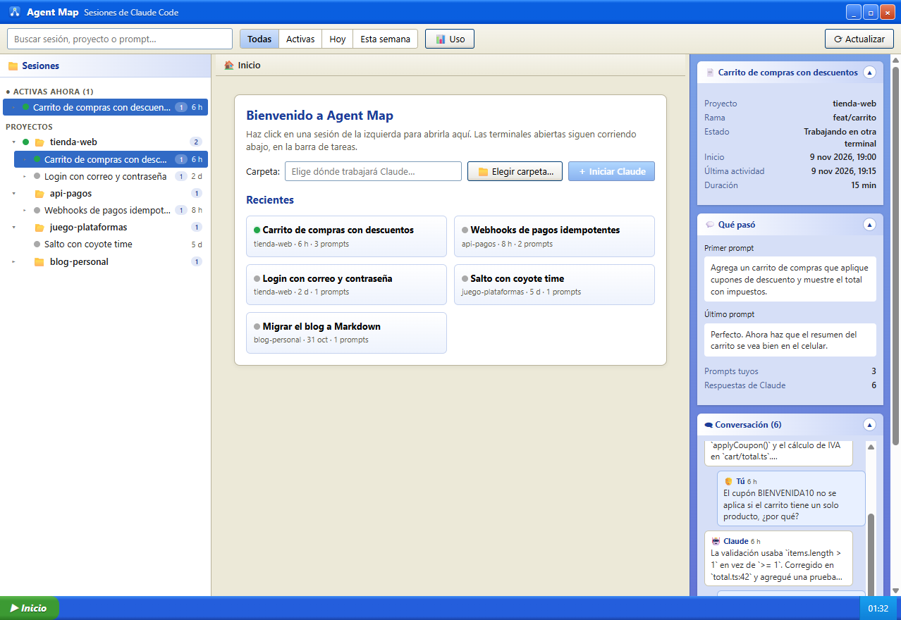
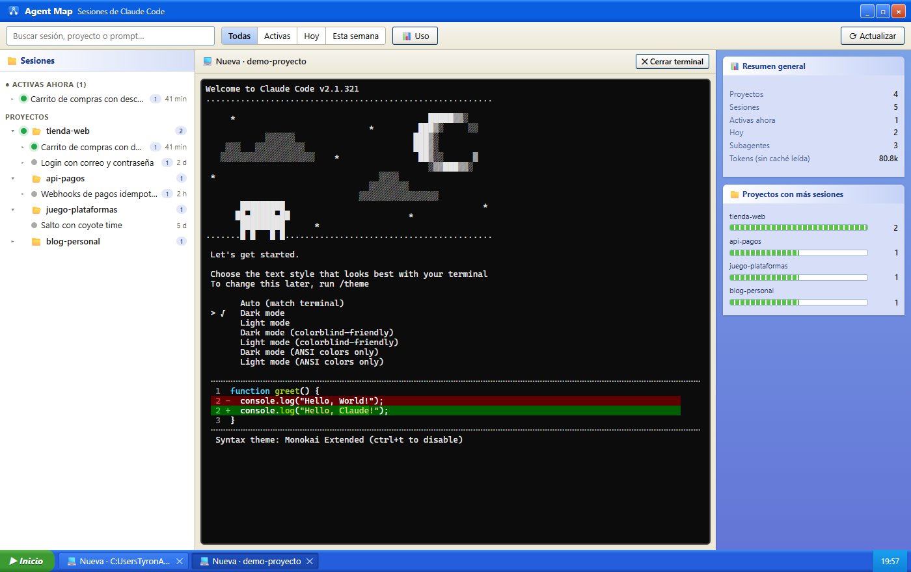
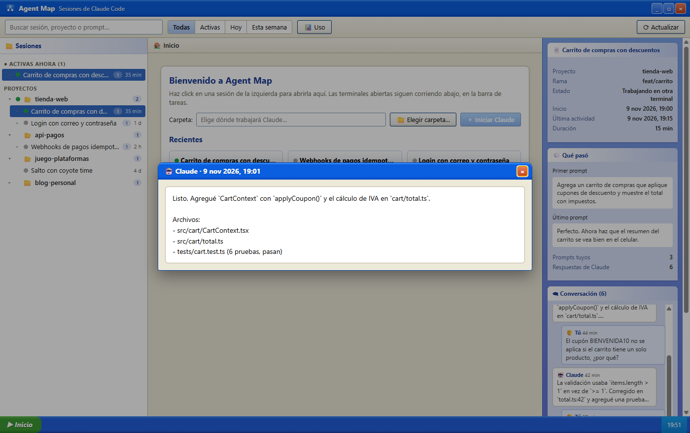
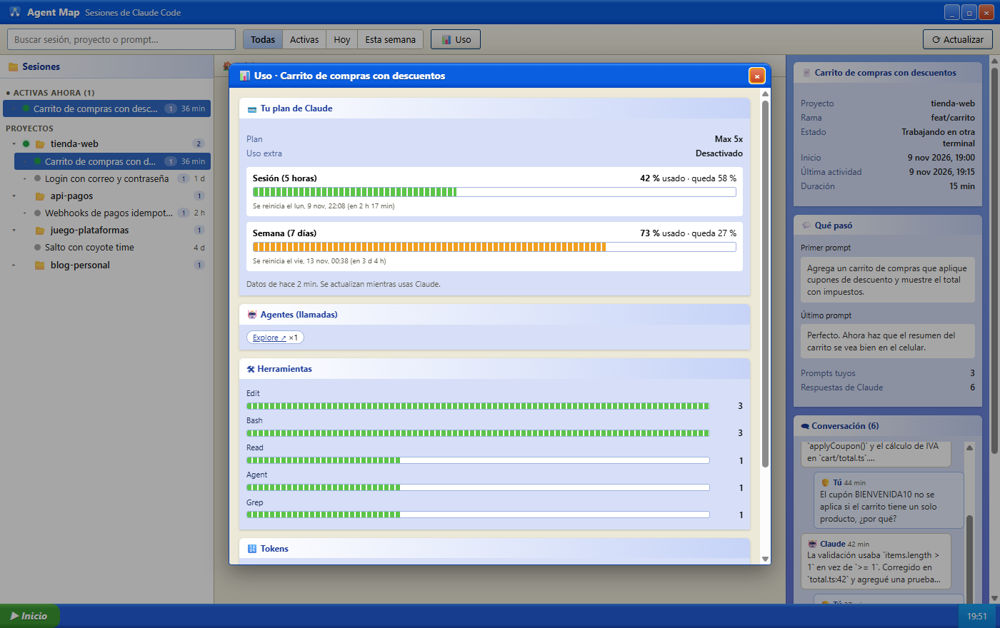
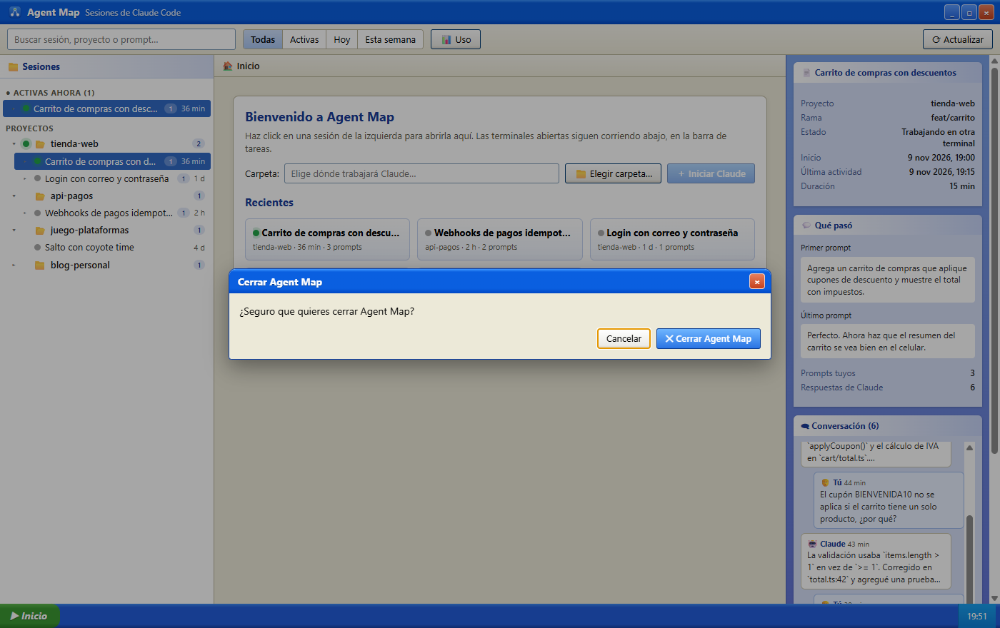

# Agent Map

**Todas tus sesiones de Claude Code en una sola ventana, con terminales reales y estilo Windows XP.**

Agent Map es una app de escritorio para Windows. Lee las conversaciones que Claude Code guarda en tu equipo, las ordena por proyecto y te deja retomar cualquiera con un click, en una terminal real dentro de la misma ventana. También muestra qué dijiste, qué respondió Claude, qué agentes usó y cuánto te queda del plan.



**[⬇ Descargar el instalador para Windows](https://github.com/TyronQuezada/agent-map/releases/latest)** · [Manual completo](MANUAL.md)

---

## Características

### 🗂 Todas tus sesiones, ordenadas
- Árbol **proyecto → sesión → subagentes**, con las sesiones más recientes arriba.
- Sección **Activas ahora** con las sesiones que tienen Claude corriendo en este momento.
- **Puntos de estado** en cada sesión y en la carpeta del proyecto:
  🟠 abierta en Agent Map · 🟢 trabajando · 🔵 en espera · ⚪ cerrada.
- **Buscador** por título, prompt, proyecto, rama o agente, y filtros **Todas / Activas / Hoy / Esta semana**.

### 💻 Terminales reales dentro de la app
- Click en una sesión y se abre con `claude --resume`, en una terminal de verdad (ConPTY + xterm.js).
- Las terminales siguen vivas aunque cambies de sesión. Las encuentras en la **barra de tareas** de abajo, como en Windows.
- **Iniciar Claude en cualquier carpeta**, con un explorador que también crea carpetas nuevas para empezar un proyecto desde cero.
- Al cerrar una terminal se detiene Claude **y todo lo que lanzó** (servidores MCP, comandos). La conversación queda guardada.



### 🗨 La conversación, lista para leer
- El panel derecho muestra **tus prompts y las respuestas de Claude** de la sesión elegida, en orden, como un chat.
- **Click en cualquier mensaje** y se abre completo en un popup.
- Primer y último prompt resumidos, para saber de qué iba la sesión de un vistazo.
- Se ocultan los recordatorios internos que agrega Claude Code, las llamadas a herramientas y el razonamiento interno.



### 📊 Uso del plan y estadísticas
- **Plan de Claude** (Pro, Max…), **% usado en la sesión de 5 horas y en la semana**, cuánto queda y cuándo se reinicia. La barra se pone naranja desde 70 % y roja desde 90 %.
- Agentes, herramientas, tokens y modelos usados, por sesión o en total.
- Cada agente tiene un link a su repositorio (plugins) o a la documentación oficial (agentes integrados).



### 🪟 App de escritorio de verdad
- Se instala, se ancla a la barra de tareas y abre sin navegador ni comandos.
- Botones de minimizar, maximizar y cerrar propios del estilo XP.
- **Al cerrar pregunta si estás seguro** y avisa cuántas terminales se van a detener.
- Instancia única: si la abres dos veces, enfoca la ventana que ya está abierta.



> Las capturas usan datos de ejemplo, no sesiones reales.

---

## Instalación

1. Descarga **`Agent-Map-Setup-x.y.z.exe`** desde [Releases](https://github.com/TyronQuezada/agent-map/releases/latest).
2. Ejecútalo. Se instala para tu usuario, sin permisos de administrador, y puedes elegir la carpeta.
3. Crea accesos directos en el escritorio y en el menú Inicio. Para anclarla: con la app abierta, click derecho en su icono de la barra de tareas → **Anclar a la barra de tareas**.

> Windows puede mostrar **"Windows protegió su PC"** porque el instalador no está firmado con un certificado de pago. Pulsa **Más información → Ejecutar de todas formas**.

### Requisitos

- Windows 10 u 11 (x64).
- [Claude Code](https://code.claude.com) instalado y disponible como `claude` en el PATH.
- Node.js en el PATH, solo para ver el % de uso del plan (ver abajo).

### Ver el % de uso del plan

Claude Code entrega el uso del plan únicamente a tu comando de *statusline*. Agent Map copia un pequeño intermediario a `~/.agent-map/statusline-tap.mjs`. Para activarlo, antepón ese intermediario a tu statusline en `~/.claude/settings.json`:

```json
"statusLine": {
  "type": "command",
  "command": "node \"C:\\Users\\<tú>\\.agent-map\\statusline-tap.mjs\" <tu statusline de siempre>"
}
```

El intermediario guarda solo los límites de uso en `~/.agent-map/usage.json` y luego ejecuta tu statusline con la misma entrada, así que tu barra se ve igual. Detalles en el [manual](MANUAL.md#6--uso).

---

## Privacidad y seguridad

- **Todo es local.** Agent Map no envía nada a internet.
- Lee `~/.claude/projects/**/*.jsonl` y `~/.claude/sessions/*.json` **solo en modo lectura**. Nunca lee tus credenciales.
- El servidor interno escucha solo en `127.0.0.1`, en un puerto al azar, y rechaza peticiones con `Host` u `Origin` ajenos (protección contra DNS rebinding y otras webs).
- La interfaz corre con `contextIsolation` y `sandbox`: no tiene acceso a Node, solo a los botones de la ventana.
- Los links externos se abren en tu navegador, nunca dentro de la app.
- Lo único que escribe va a `~/.agent-map/` (uso del plan, intermediario de statusline y un log de arranque y cierre).

---

## Desarrollo

```
npm install
npm start          # app de escritorio en modo desarrollo
npm run web        # modo navegador en http://localhost:4317
npm test           # pruebas (node --test)
npm run dist       # icono + instalador en dist/
```

Sin frameworks en la interfaz: HTML, CSS y JavaScript con `innerHTML` y delegación de eventos.

| Archivo | Qué hace |
|---|---|
| `electron/main.js` | ventana sin marco, botones, confirmación de cierre, instancia única, log |
| `electron/preload.cjs` | puente mínimo entre la página y la ventana |
| `server.js` | API local, terminales (`node-pty`) y archivos de la interfaz |
| `lib/scan.js` | lectura de sesiones, conversación, plan y repos de plugins |
| `lib/folders.js` | explorador y creación de carpetas |
| `statusline-tap.js` | intermediario de la statusline (uso del plan) |
| `public/` | interfaz |
| `scripts/make-icon.js` | genera el icono (PNG e ICO) sin dependencias |

Hecho con [Electron](https://www.electronjs.org/), [node-pty](https://github.com/microsoft/node-pty), [xterm.js](https://xtermjs.org/) y [ws](https://github.com/websockets/ws).
